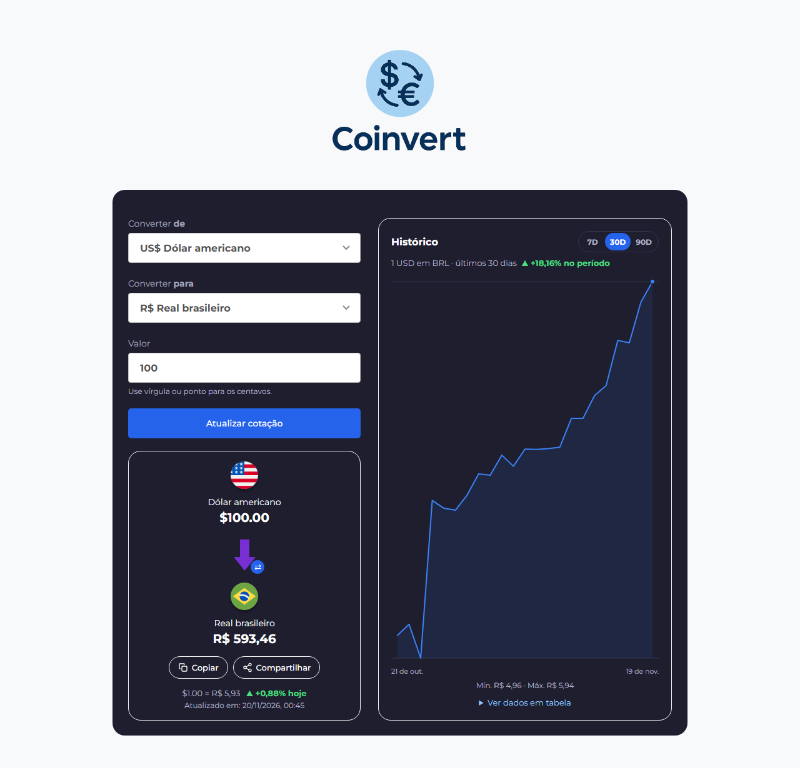
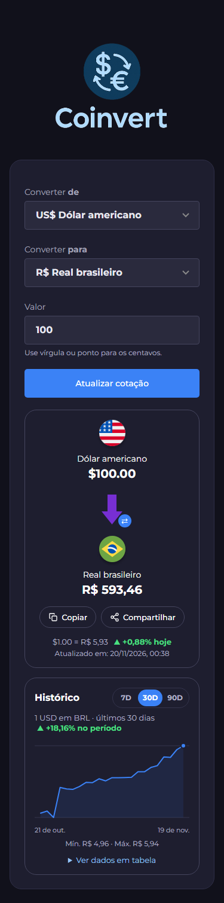

<div align="center">


# Coinvert

**Conversor de moedas com cotações em tempo real, histórico em gráfico e funcionamento offline.**
Feito em HTML, CSS e JavaScript puros, sem framework e sem build.

[**Acessar o site →**](https://ryan-pro10.github.io/convert-coin/)

[](https://github.com/Ryan-pro10/convert-coin/actions/workflows/tests.yml)

</div>

<picture>
  <source media="(prefers-color-scheme: dark)" srcset="docs/desktop-dark.png">
  
</picture>

## Funcionalidades

- **Cotação em tempo real** de Real, Dólar, Euro, Libra, Bitcoin e Guarani, via [AwesomeAPI](https://docs.awesomeapi.com.br/api-de-moedas)
- **Qualquer par de moedas**: a conversão passa pelo Real quando a API não tem o par direto (ex.: Bitcoin → Guarani)
- **Conversão automática** enquanto você digita, com botão ⇄ para inverter as moedas
- **Variação do dia** (▲ +0,87% hoje) e **gráfico do histórico** de 7, 30 ou 90 dias, com tooltip, navegação por teclado e tabela de dados
- **Link compartilhável**: a URL guarda a conversão (`?de=USD&para=BRL&valor=250`), e o botão Compartilhar abre o menu nativo do celular
- **Lembra sua última escolha** e copia o resultado com um toque
- **Funciona offline e pode ser instalado** como app (PWA): usa a última cotação salva e avisa que ela pode estar desatualizada
- **Formatação correta de cada moeda**: R$ 1.234,56 · $1,234.56 · 1.234,56 € · ₿ 0.00012346 · Gs. 1.234
- **Campo de valor inteligente**: aceita `1.234,56` e `1,234.56` e bloqueia letras e números negativos
- **Modo escuro automático**, layout responsivo de 320px a telas largas e foco em acessibilidade (rótulos, `alt`, `aria-live`, navegação por teclado)

<p align="center">
  
</p>

## Tecnologias

| | |
|---|---|
| **Front-end** | HTML5, CSS3 (variáveis, grid, `prefers-color-scheme`) e JavaScript (ES2022) |
| **Dados** | [AwesomeAPI](https://economia.awesomeapi.com.br): cotações (`/json/last`) e histórico (`/json/daily`) |
| **Gráfico** | SVG desenhado à mão, sem biblioteca |
| **Offline** | Service Worker, Web App Manifest e `localStorage` |
| **Testes** | `node:test` (executor nativo do Node, sem dependências) e GitHub Actions |
| **Hospedagem** | GitHub Pages |

## Como rodar localmente

```bash
git clone https://github.com/Ryan-pro10/convert-coin.git
cd convert-coin
```

Abra o `index.html` com o **Live Server** do VS Code (botão direito → *Open with Live Server*).

> Dá para abrir o `index.html` direto no navegador, mas o modo offline (service worker) só funciona servido por `http://`, como no Live Server ou no GitHub Pages.

## Testes

São 76 testes sobre a leitura do valor digitado, a formatação, as conversões, o cache, o histórico, o link compartilhável e a integridade do PWA. Não é preciso instalar nada, só ter o [Node.js](https://nodejs.org) 20 ou mais recente:

```bash
npm test
```

Os testes também rodam no GitHub Actions a cada push e pull request.

## Estrutura

```
├── index.html              Página (marcação, SEO e acessibilidade)
├── styles.css              Estilos, modo escuro e responsividade
├── sw.js                   Service worker (offline)
├── manifest.webmanifest    Dados do app instalável
├── js/
│   ├── currencies.js       Catálogo de moedas (nome, imagem, formatação)
│   ├── format.js           Formatação de moedas/datas e leitura do valor digitado
│   ├── api.js              AwesomeAPI, cache e cálculo das conversões
│   ├── prefs.js            Última escolha (localStorage) e link compartilhável (URL)
│   ├── chart.js            Gráfico do histórico em SVG
│   ├── pwa.js              Registro do service worker e botão "Instalar app"
│   └── ui.js               Eventos e atualização da tela
├── img/  icons/  docs/     Imagens das moedas, ícones do app e prints do README
└── tests/                  Testes automatizados
```

<details>
<summary><b>Como adicionar uma nova moeda</b></summary>

1. Adicione a imagem em `img/` (52×52px, nome sem espaços).
2. Adicione uma entrada em [`js/currencies.js`](js/currencies.js) com o código ISO, por exemplo `JPY`, que é o mesmo código usado na AwesomeAPI.
3. Adicione a opção nos dois `<select>` do [`index.html`](index.html).
4. Inclua a imagem na lista `SHELL` do [`sw.js`](sw.js) e aumente a `VERSION` (ex.: `"v2"`).
5. Rode `npm test`: os testes avisam se algum desses passos ficou faltando.

</details>

## Sobre

Um dos meus primeiros projetos com JavaScript, criado durante os estudos no [DevClub](https://aulas.devclub.com.br/) 👨‍💻 e depois evoluído com API em tempo real, PWA, gráfico e testes.

Cotações fornecidas pela [AwesomeAPI](https://docs.awesomeapi.com.br/api-de-moedas).
